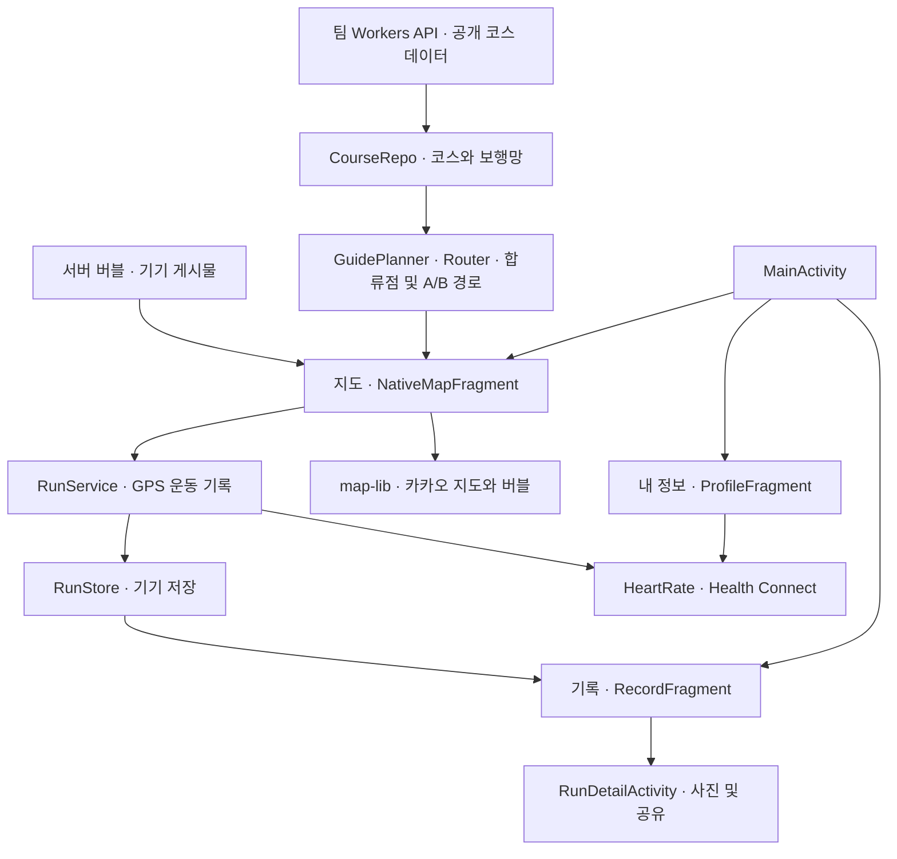

# 뛰고보자 Android 앱

부울경 코스를 고르고 지도에서 합류 지점까지 이동한 뒤, 선택한 방향으로 달리고 기록을 남기는 앱입니다.

## 앱 구조도



| 위치 | 담당 |
| --- | --- |
| [앱 모듈](app/src/main/) | 화면, 코스 선택, 달리기 서비스, 기록, 권한, 업데이트 |
| [지도 모듈](map-lib/src/main/) | 카카오 지도, 경로선, 합류점, 버블 묶음, 위치 필터 |
| [건강 연동 모듈](../android/health-connect/) | 팀 저장소에서 관리하는 Health Connect 라이브러리 |
| [앱 데이터](app/src/main/assets/) · [리소스](app/src/main/res/) | 지역 코스, 고도 표본, 시연 사진, 아이콘 |
| [서버](server/) · [데이터 도구](tools/) · [개발 스크립트](scripts/) | 버블 API 구현, 코스·에셋 생성, 에뮬레이터 조작 |

## 2.6 지도 버블 · 2026-11-28

빌드 30에서는 처음 위치가 잡히면 해운대 10개 코스의 합류 경로와 방향별 안내를 준비합니다. 지도에서 파란 실선은 보행 경로를, 점선은 보행로 입구나 합류점 방향을 뜻합니다. 점선 거리는 안내하는 도보 거리에 포함하지 않습니다. 동백공원 순환길과 짧은 B코스의 완주 판정도 수정했습니다.

빌드 29에서는 지도를 멀리 축소해도 내 위치 버블을 48dp로 표시합니다.

내 위치 버블과 일반 글 버블의 너비를 48dp로 맞췄습니다. 버블이 겹치면 내 위치가 맨 앞에 표시됩니다. 내 정보 하단에는 버전과 앱 이름을 두 줄로 표시합니다.

## 2.5 합류 안내 · 2026-11-28

- 길을 고르면 현재 위치와 합류점을 한 화면에 표시합니다. 파란 선과 화살표를 따라 합류하고, 도보 경로 데이터가 없는 곳에서는 카카오맵 도보 길찾기를 열 수 있습니다.
- 지도에는 선택한 길과 합류 경로 주변 100m 이내의 신고 버블을 남깁니다. 버블이 내 위치와 겹치면 버블을 위에 표시합니다.
- 길 안내는 위치 잠금을 풀고 시작합니다. 형광 연두색 자물쇠를 누르면 내 위치를 따라갑니다. 시작 화면에는 흰색 ‘뛰고보자’ 이미지를 사용합니다.

## 2.4 길찾기 수정 기록 · 2026-11-28

Android 2.4(버전 코드 26)를 배포했습니다. 기존 사용자는 앱의 업데이트 확인에서 받을 수 있습니다. [버전별 APK 및 패치 내역](https://yumin-server.duckdns.org/files/)

- **증상** · 달맞이 고갯길과 수영강 바람길에서 GPS를 잡고도 출발 버튼이 “조금 더 가까이”라는 메시지를 띄웠습니다. 기존 코드가 가까운 노드 한 곳만 검사하고, 제한값보다 긴 우회 경로를 버리면서 합류 경로가 비었습니다.
- **수정** · 보행로 선분과 코스의 여러 합류 후보를 비교합니다. 가까운 후보로 갈 수 없으면 보도 정보가 있는 도로와 보행 허용 구간을 포함해 코스 전체에서 연결점을 찾습니다.
- **안내** · 앱 안에서 합류점을 거쳐 고른 A/B 방향으로 이어집니다. 보행망이 끊긴 구간은 합류점까지의 직선거리로 표시하고 이동하면서 경로를 다시 탐색합니다.
- **확인** · 기존에 실패한 테스트 좌표에서 달맞이 553m, 수영강 234m의 합류 경로를 확인했습니다. 수정본은 Android 에뮬레이터에 설치했습니다.

## 빌드

Android Studio에서 이 폴더를 열거나, JDK 17 및 Android SDK 36 환경에서 저장소 루트 기준으로 실행합니다.

```sh
cd app
./gradlew :app:assembleDebug
```

지도 실행용 Kakao 네이티브 앱 키는 이 폴더의 로컬 설정 파일 `local.properties`에 `KAKAO_APP_KEY`로 지정합니다. APK는 `app/build/outputs/apk/debug/app-debug.apk`에 생성됩니다.
