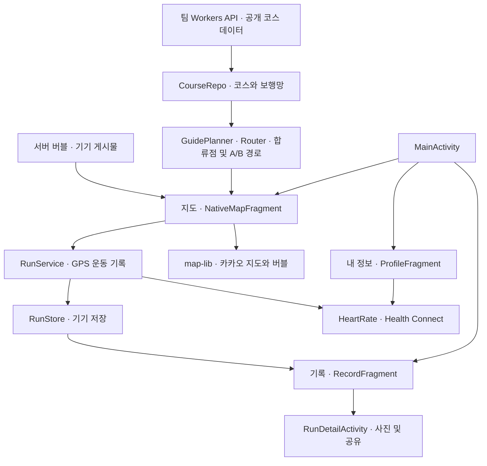

# 뛰고보자 Android 앱

부울경 코스를 고르고 지도에서 합류 지점까지 이동한 뒤, 선택한 방향으로 달리고 기록을 남기는 앱입니다.

## 앱 구조도



| 위치 | 담당 |
| --- | --- |
| [앱 모듈](app/src/main/) | 화면, 코스 선택, 달리기 서비스, 기록, 권한, 업데이트 |
| [지도 모듈](map-lib/src/main/) | 카카오 지도, 경로선, 합류점, 버블 묶음, 위치 필터 |
| [건강 연동 모듈](../android/health-connect/) | 팀 저장소에서 관리하는 Health Connect 라이브러리 |
| [앱 데이터](app/src/main/assets/) · [리소스](app/src/main/res/) | 지역 코스, 고도 표본, 시연 사진, 아이콘 |
| [서버](server/) · [데이터 도구](tools/) · [개발 스크립트](scripts/) | 버블 API 구현, 코스·에셋 생성, 에뮬레이터 조작 |

## 2.4 길찾기 수정 기록 · 2026-11-28

Android 2.4(버전 코드 26)를 배포했습니다. 기존 사용자는 앱의 업데이트 확인에서 받을 수 있습니다. [버전별 APK 및 패치 내역](https://yumin-server.duckdns.org/files/)

- **증상** · 달맞이 고갯길과 수영강 바람길에서 GPS를 잡고도 출발 버튼이 “조금 더 가까이”라는 메시지를 띄웠습니다. 기존 코드가 가까운 노드 한 곳만 검사하고, 제한값보다 긴 우회 경로를 버리면서 합류 경로가 비었습니다.
- **수정** · 보행로 선분과 코스의 여러 합류 후보를 비교합니다. 가까운 후보로 갈 수 없으면 보도 정보가 있는 도로와 보행 허용 구간을 포함해 코스 전체에서 연결점을 찾습니다.
- **안내** · 앱 안에서 합류점을 거쳐 고른 A/B 방향으로 이어집니다. 보행망이 끊긴 구간은 합류점까지의 직선거리로 표시하고 이동하면서 경로를 다시 탐색합니다.
- **확인** · 기존에 실패한 테스트 좌표에서 달맞이 553m, 수영강 234m의 합류 경로를 확인했습니다. 수정본은 Android 에뮬레이터에 설치했습니다.

## 빌드

Android Studio에서 이 폴더를 열거나, JDK 17 및 Android SDK 36 환경에서 저장소 루트 기준으로 실행합니다.

```sh
cd app
./gradlew :app:assembleDebug
```

지도 실행용 Kakao 네이티브 앱 키는 이 폴더의 로컬 설정 파일 `local.properties`에 `KAKAO_APP_KEY`로 지정합니다. APK는 `app/build/outputs/apk/debug/app-debug.apk`에 생성됩니다.
