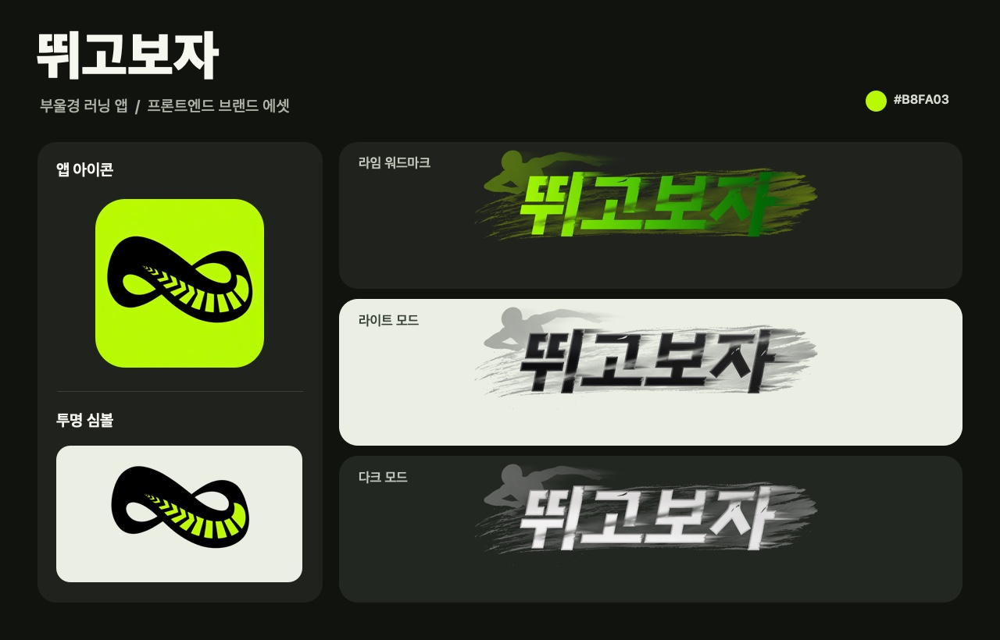

# 뛰고보자 브랜드 에셋

무한대는 계속 달리는 흐름을, 띠 안의 신발 밑창은 러닝을 표현합니다. 앱 아이콘은 라임 `#B8FA03`을 기준으로 사용합니다.

| 파일 | 크기 | 사용처 |
| --- | --- | --- |
| [라임 앱 아이콘](assets/app-icon-lime.png) | 1254 × 1254 | 앱 아이콘, 프로젝트 썸네일 |
| [투명 무한대 심볼](assets/infinity-mark.png) | 1254 × 1254 | 밝은 UI, 지도·웹 헤더 |
| [라임 워드마크](assets/wordmark-lime.png) | 2172 × 724 | 어두운 소개 배너, 시작 화면 |
| [검정 워드마크](assets/wordmark-black.png) | 2172 × 724 | 라이트 모드 |
| [흰색 워드마크](assets/wordmark-white.png) | 2172 × 724 | 다크 모드 |

원본 PNG는 `assets/`에 있습니다. 적용할 때 가로세로 비율을 유지하고, 투명 파일은 실제 배경색에서 대비를 확인합니다. Android 앱과 웹 지도에 들어 있는 기존 리소스는 유지됩니다.
